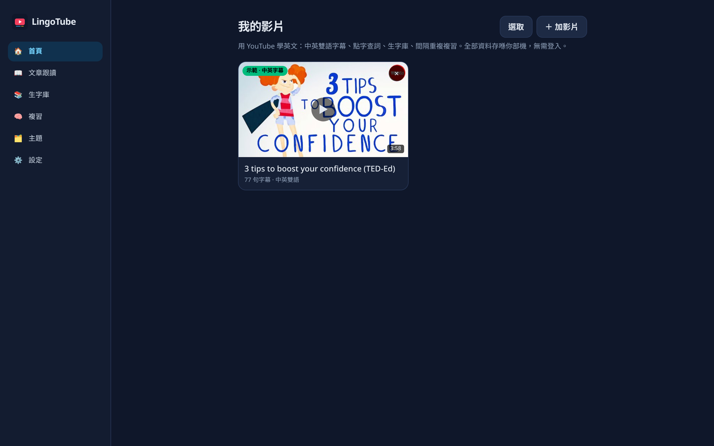
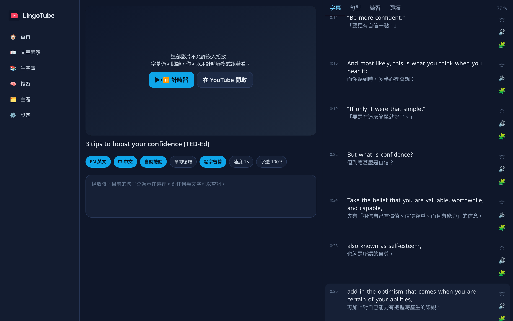
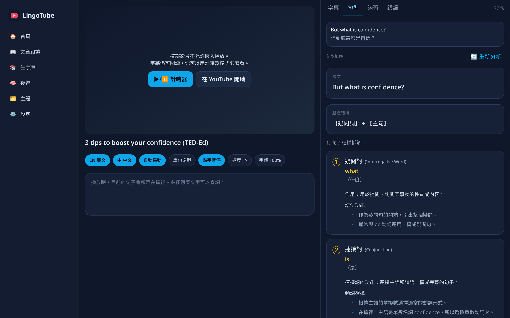
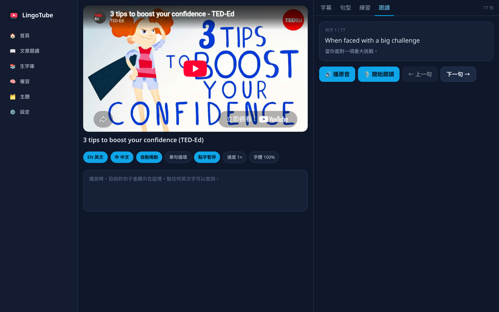
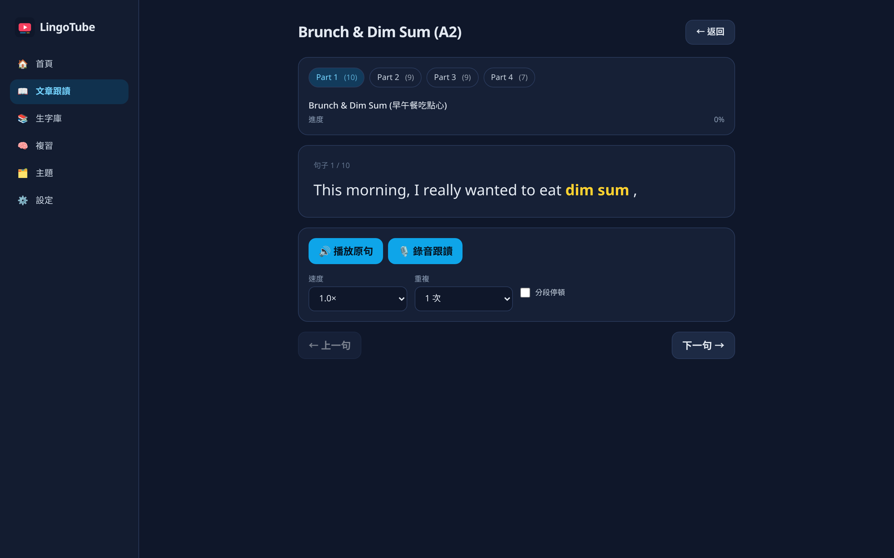
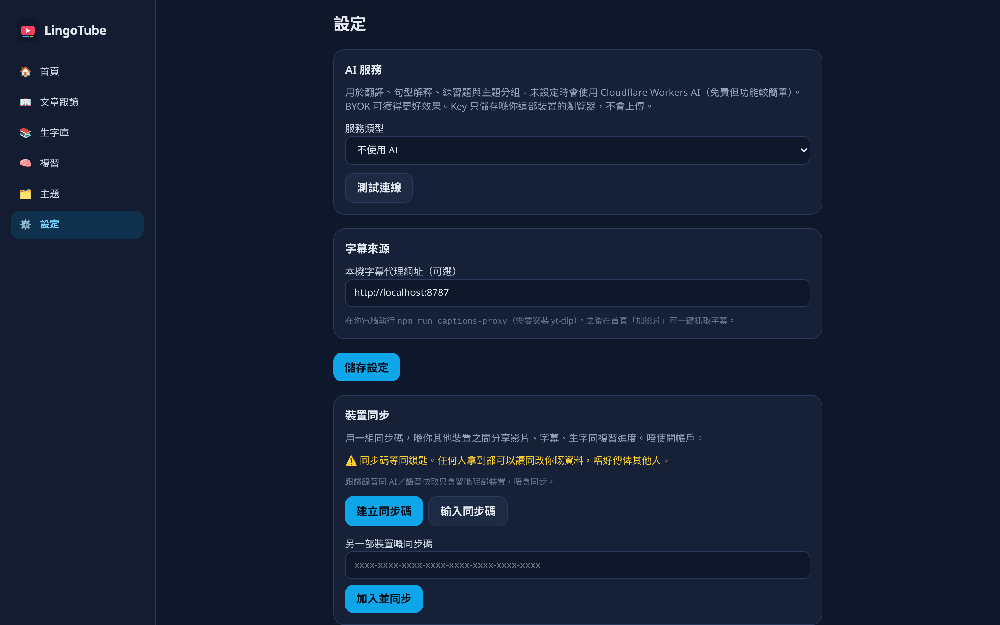
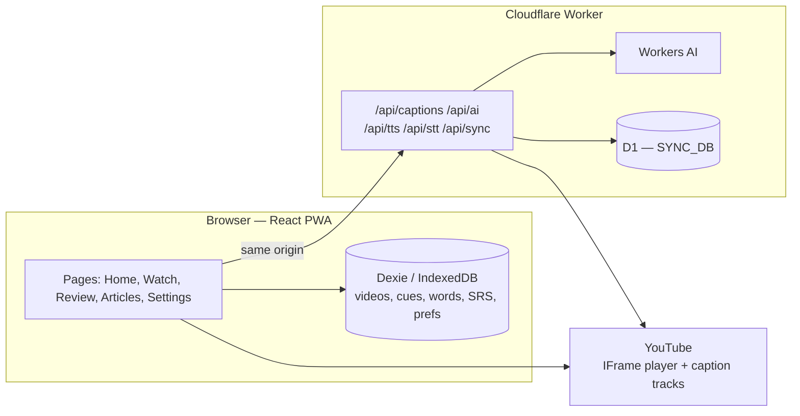

# LingoTube

用 YouTube 學英文的本地優先 PWA：雙語字幕、點字查詞、跟讀評分，不用註冊。

A local-first English-learning PWA: watch YouTube with bilingual subtitles, tap a word to look it up, practise shadowing, and review with spaced repetition — all on your device, with optional code-based sync and no account required.

**Live demo:** [https://lingotube.hackerkurumi.workers.dev](https://lingotube.hackerkurumi.workers.dev)

The demo is a personal Cloudflare Worker deployment. You can try the bundled TED-Ed video immediately; it works even if YouTube is blocked, because the captions ship with the app.

## Screenshots

The shots below were taken from the live demo, using the bundled TED-Ed lesson and the built-in “Brunch & Dim Sum” article. No personal data.

| Home | Watch (bilingual subtitles) |
| --- | --- |
|  |  |

| Sentence breakdown (句型拆解) | Shadowing (跟讀) |
| --- | --- |
|  |  |

| Article shadowing (文章跟讀) | Settings: device sync |
| --- | --- |
|  |  |

## Features

- **Bilingual subtitles** on a YouTube video: English, Chinese, Japanese, or Korean as the primary line, with a secondary translation line when one is available.
- **Auto-fetch captions** from YouTube in the browser (server-side Worker), preferring human-written tracks over auto-generated ones. Manual import of `.srt`, `.vtt`, and YouTube-style `.txt` transcripts as a fallback.
- **Tap-to-define** on English words: Traditional Chinese gloss, English definition, IPA, and pronunciation. Save words and whole sentences to a vocab bank.
- **Spaced repetition** (SM-2 style) for words and sentences.
- **句型拆解:** AI breakdown of an English sentence (components, roles, grammar notes in Traditional Chinese). Cached on the device.
- **練習 and 主題:** generated exercises and theme grouping for saved items (Workers AI, or your own OpenAI-compatible key).
- **跟讀 (video shadowing):** play the line from the video, record yourself, then play both back. Scoring uses phonetic matching (Metaphone) plus Levenshtein alignment and colours words as exact / close / missed.
- **文章跟讀:** practise a passage split into stressed chunks (bundled A2 “Brunch & Dim Sum” demo, or paste your own).
- **同步碼:** share videos, captions, vocab, and review progress across your own devices with a 128-bit hex code (and a local QR). No account. Recordings and AI/TTS caches stay on the device.
- **PWA:** installable, hash-routed, works offline for content already on the device.

## Architecture



The UI is a static Vite app served by the same Worker as the APIs. Application data lives in IndexedDB first. The Worker is only needed for caption fetch, AI, TTS/STT, and sync.

## Tech stack

| Layer | Choice |
| --- | --- |
| App | Vite, React 19, TypeScript, HashRouter |
| UI | Tailwind CSS v4, Traditional Chinese (and Cantonese) copy, mobile-first |
| PWA | `vite-plugin-pwa`, Workbox precache |
| Local data | Dexie (IndexedDB) |
| Video | YouTube IFrame Player API; timer fallback when a video cannot be embedded |
| Captions | Cloudflare Worker talks to YouTube InnerTube / timedtext; optional local `yt-dlp` proxy |
| Dictionary | Bundled offline gloss for the demo → IndexedDB cache → dictionaryapi.dev + MyMemory |
| AI | Cloudflare Workers AI by default (Llama 3.3 70B for sentence structure, smaller models as fallback). Optional BYOK for any OpenAI-compatible API |
| Speech | Google Translate TTS proxy (chunked), with Workers AI Aura / MeloTTS as fallback; STT via Workers AI; browser `speechSynthesis` for quick playback |
| Sync | Cloudflare D1, hashed sync codes, last-write-wins |
| Scoring | Metaphone + Levenshtein word alignment |

## Engineering decisions

**Local-first.** Videos, cues, vocab, and review state are written to IndexedDB on the device. The bundled demo and dictionary gloss work with no network. API keys entered in Settings never leave the browser and are excluded from JSON export.

**Sync via a code, not an account.** A 128-bit code is the shared secret. The server stores only `SHA-256(code)` in D1, never the code itself. Anyone who has the code can read and update that space, so the UI treats it as a key. Sync covers videos and cues, words, sentences, and per-video prefs. It does not sync recordings or AI/TTS caches.

**Last-write-wins with tombstones and a server sequence cursor.** Each record has an `updatedAt`. The client pushes dirty rows; the server assigns a monotonic `seq` per space. Pull is `WHERE seq > cursor`. Deletes propagate as tombstones so a row removed on one device does not reappear from another. A tombstone also prevents the bundled demo from being re-seeded after you delete it.

**AI model fallbacks.** Sentence structure prefers `@cf/meta/llama-3.3-70b-instruct-fp8-fast`, then smaller Llama instruct models if that call fails. Caption translation can use a native Chinese track, YouTube’s own `tlang`, Workers AI, or the public Google gtx endpoint, in that order.

**TTS proxy chunking.** `GET /api/tts` proxies Google Translate TTS and splits text into ~200-character chunks at punctuation. If that path fails, the Worker falls back to Workers AI TTS. Responses can be cached at the edge.

**Fuzzy pronunciation scoring.** A recognised transcript is aligned to the prompt with Metaphone (so “confidence” and a close mis-hearing can still match) and Levenshtein distance. The UI colours words as 正確 / 接近 / 漏咗 and shows an overall percentage. This is a practice aid, not a formal pronunciation exam, and it is built around English.

## Running locally

```bash
npm install
npm run dev          # http://localhost:5173
```

Auto-fetch captions, Workers AI, TTS, and STT call `/api/*` on the same origin, so those paths need the deployed Worker (or a proxy to it). Locally you can still:

- Use the bundled TED-Ed demo (captions included)
- Import `.srt` / `.vtt` / `.txt` on the home page
- Run a local [yt-dlp](https://github.com/yt-dlp/yt-dlp) proxy and use **用本機代理抓字幕**:

```bash
npm run captions-proxy    # 127.0.0.1:8787
# if YouTube asks for a sign-in:
# YT_COOKIES_FROM_BROWSER=chrome npm run captions-proxy
```

Production preview of the PWA (service worker only runs on the built app):

```bash
npm run build
npm run preview          # http://localhost:4173
```

## Deploying your own Worker

You need a Cloudflare account, Workers AI, and a D1 database.

1. Create the database and apply the schema:

   ```bash
   npx wrangler d1 create lingotube-sync
   npx wrangler d1 execute lingotube-sync --file=deploy/schema.sql
   ```

2. Copy the examples and fill in the D1 id (do not commit the filled files — they are gitignored):

   ```bash
   cp wrangler.toml.example wrangler.toml
   cp .env.example .env
   # set LINGOTUBE_D1_DATABASE_ID and the wrangler.toml database_id
   ```

3. Build the front end and bundle it with the Worker:

   ```bash
   npm run build
   node deploy/build-worker.mjs    # writes deploy/worker.js
   npx wrangler deploy
   ```

`deploy/build-worker.mjs` also writes `deploy/deploy-code.js` for a Cloudflare API upload. That helper reads `LINGOTUBE_D1_DATABASE_ID` from the environment or `.env`. It is not required if you deploy with Wrangler. Account ids and database ids should stay in env / `wrangler.toml`, not in source.

The Worker serves the SPA and these routes: `/api/captions`, `/api/ai`, `/api/tts`, `/api/stt`, `/api/sync/*`.

## Limitations and roadmap

- YouTube sometimes bot-checks caption requests. The app retries transient failures and shows a short Chinese message asking you to try later or import a file. It does not always succeed.
- Some videos (including the bundled TED-Ed demo, depending on the client) disable embedding. Subtitles and timer mode still work; “open in YouTube” is offered.
- Shadowing scores and 句型拆解 are English-oriented. For Chinese, Japanese, or Korean as the primary subtitle line, the app shows a short note and does not split CJK text into tappable words (there are no spaces to split on, and a character-by-character split would look wrong).
- Google Translate TTS is an unofficial endpoint. Aura / MeloTTS are the fallback, and quality varies.
- A 同步碼 is equivalent to a password for that space. There is no account recovery and no server-side identity.
- Article scripts themselves are not included in sync.
- Scores are computed when you open a recorded line; they are not stored as a history of attempts.

Possible next steps (not implemented): richer CJK segmentation and lookup, persisting shadowing scores, embedding more reliably, and a public issue tracker as the project is published.

## License

MIT © 2026 Gordon Yau. See [LICENSE](LICENSE).

The bundled demo video is from TED-Ed (“3 tips to boost your confidence”). English captions are TED-Ed’s; the Traditional Chinese translation in the demo was written for this project. Please respect TED-Ed’s licence if you redistribute that material.
